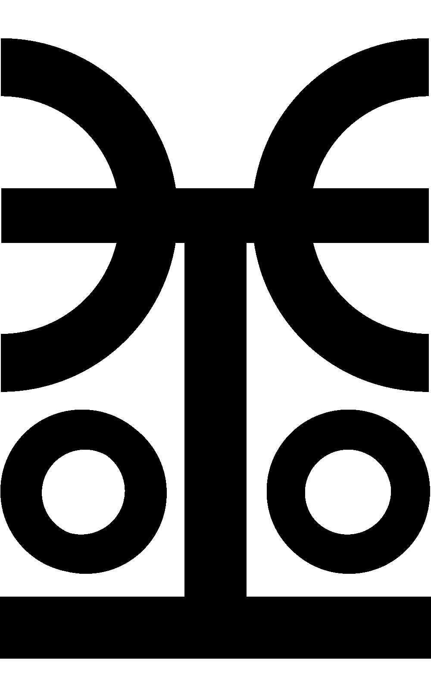
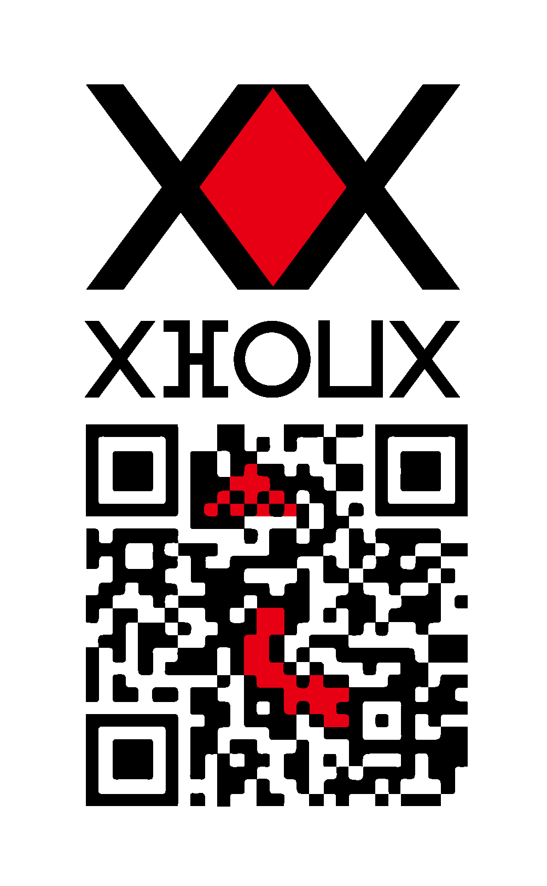

# Zen: Money You Can Hold and Send

  

Zen (from the Arabic *Mizan*, "the balance": ⵣⴻⵏ, 全, الميزان) is an open-source monetary system tied to metal. It has three physical coins of gold, silver and copper, and three electronic coins on three public chains. The metal coins are the reference. Every block of payments is checked by one small proof of 196 bytes.

> Zen is still in research and development. It runs only as a test network: the test coins have no value, and the code is not audited. Ideas, questions and criticism are welcome.

## Watch and read

  

- **Video series:** [Episode 1, A Short History of Trust](https://www.youtube.com/watch?v=c3Mrpw75twc) on YouTube
- **Blog** (Tor Browser needed): http://wmjtj25a6x3u2bzp44iei76gfprmmllm6kvd4ocr7qwsmnwkqrey3qad.onion/

## Six coins, one reference

| Physical coin | Metal | Use | Electronic twin | Block time |
|---|---|---|---|---|
| **Ren** | 4 g of gold | savings and large settlements | **Golden Yen** (1 Yen = 1 Ren, the aim) | 15 min, limited supply |
| **Ten** | 3 g of silver | salaries and trade | **Silver Ken** (1 Ken = 1 Ten, the aim) | 5 min |
| **Sen** | 2 g of copper | everyday purchases and small change | **Bronze Jen** (1 Jen = 1 Sen, the aim) | 2.5 min, launches first |

Each electronic coin aims to match its physical coin one to one, with no custodian and no price feed in between. Amounts are counted in base twelve, which divides evenly by 2, 3, 4 and 6.

## Three layers

1. **Physical coins (Ren, Ten, Sen):** 3D-printable designs, so anyone with a metal printer and their own metal can make coins. Checking a coin by hand (weight, size, sound) and making coins hard to counterfeit are open research.
2. **Electronic coins (Yen, Ken, Jen):** three linked chains that watch each other, with a built-in exchange and atomic swaps between them.
3. **Streaming (Y-, K-, J-Network, together the Z-Network):** payment channels and channel factories. You melt coins into a channel, stream payments off the chain, and cast the final balance back. Coin points connect the coin in your hand to its twin in the network.

## What is in this repository

| Folder | Contents |
|---|---|
| [`L1 - Physical Coins`](L1%20-%20Physical%20Coins) | 3D models (STL, IGES) and specifications for Ren, Ten and Sen |
| [`L2 - Cryptocurrencies/zen-rust`](L2%20-%20Cryptocurrencies/zen-rust) | the reference node, wallet and three-chain test network in Rust, with one 196-byte proof per block |
| [`L2 - Cryptocurrencies/jen0-go-devnet`](L2%20-%20Cryptocurrencies/jen0-go-devnet), [`pom-leaf-go`](L2%20-%20Cryptocurrencies/pom-leaf-go) | the first Go prototypes of collaborative minting |
| [`L3 - Channel Factories`](L3%20-%20Channel%20Factories) | notes on channels and channel factories |
| [`simulations`](simulations) | the Python and JavaScript models behind the rules |
| [`whitepaper`](whitepaper) | the white paper, [draft 0.4 (PDF)](whitepaper/Zen-white-paper-draft-0.4.pdf), and its LaTeX sources |
| [`Data Minting`](Data%20Minting) | an early data-minting prototype |
| [`docs`](docs) | the project page |

## Where the work stands

**Built and tested**
- A Rust node, wallet and three-chain test network that run on one laptop, with a wallet page in the browser.
- Payments, payment channels, channel factories, vaults, orders and auctions.
- One 196-byte proof per block covering payments and all of these operations (Plonky2, wrapped in Groth16). A node checks it in a few milliseconds.
- 583 rule-breaking tests that try to make the proof circuits accept something the node refuses. None succeeds.
- 137 automated tests pass. The code was written with AI assistance and is tested in the open.

**Needed next**
- A public multi-party ceremony to create the proof key. Today's key was made on one machine and is for testing only.
- An independent audit of the circuits and the consensus rules.
- Fuzzing of every message decoder.
- A public test network that others can join.
- Speed tests of the proof builder on GPU servers, and of the wallet on phones.

## Help build it

Zen needs people who will look for what is wrong with it. An hour of careful review is worth more than praise.

- **Cryptographers:** read the proof circuits and the soundness tests, and try to break them.
- **Rust developers:** review the node, the transport and the wallet, write fuzzers, and fix what you find.
- **Ceremony participants:** take part in the public setup of the proof key. One honest participant is enough.
- **Testers:** run the test network on a Mac or Linux machine and report what fails.

Open an issue or a pull request to get started.

## Support the work

Donations pay for an independent audit, the public ceremony and time on build machines. This is a donation to open-source development. It is not an investment, and it gives no right to coins, tokens or returns.

- **Giveth:** https://www.giveth.io/project/zen-money-you-can-hold-and-send
- **Bitcoin:** `3Di7NCacvRmsRxxZ8Q6VDoXniVFZBrV8Pw`

  

## License

The code is under the [Apache License 2.0](LICENSE).

---

Zen, by Justus L. Ludovic. This project has no connection to any meme coin or token on pump.fun or other platforms.
